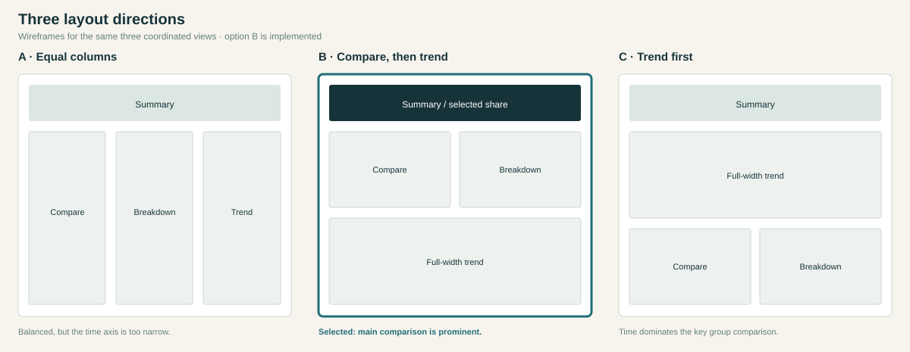

# Week 5 Proposal: Food Budget Atlas

**Status:** Complete design draft for student review. The course requires the student to make the final layout and encoding decisions; the student should review this proposal and be able to explain each choice before submitting it.

## Dataset and question

The public dataset is the U.S. Bureau of Labor Statistics (BLS) Consumer Expenditure Surveys (CE), accessed through the [BLS Public Data API](https://www.bls.gov/developers/api_signature_v2.htm). Each of the 50 rows represents an annual average for one income-before-taxes quintile in one year, 2015–2024. The series include total expenditures, all food, food at home, and food away from home, in current U.S. dollars per consumer unit. Derived fields are all-food, home, and away shares of total expenditures. There are no missing year–quintile combinations or spending measures in the frozen extract. See [sources](sources.md) for series IDs and transformations.

The topic connects food to personal finance without relying on a vague claim about affordability. The dashboard asks a precise descriptive question: **How much of each group's annual expenditure budget goes to food, and how is that share split between home and away?** A higher food share is not itself a measure of food insecurity. The data are group means, not individual spending histories.

### Three answerable research questions

1. In a selected year, how does food's share of total expenditures compare across the five income quintiles?
2. How much of that share comes from food at home versus food away from home for each quintile?
3. How did those shares change from 2015 to 2024, including the visible change around 2020?

The dashboard does not test causes of those differences; the data do not establish them.

## Tool and layout sketches

**Tool:** D3.js in a lightweight Vite web app. D3 permits the exact shared selection state and direct manipulation required by the assignment, plus responsive SVGs, tooltips, and keyboard focus. The working local app is the submission route.

- **A — three equal columns:** makes each view equal, but compresses the ten-year time axis.
- **B — selected:** summary first; compare and breakdown side by side; full-width trend below. This gives the central comparison priority while keeping the two quintile views visually grouped.
- **C — trend first:** emphasizes change over time, but puts the main share comparison below the fold.

## Channel justification table

| Data variable | Data type | Mark | Channel | Principle | Why it fits |
| --- | --- | --- | --- | --- | --- |
| Food share of total expenditures (%) | Quantitative | Dot, line point, bar length | Horizontal position in Views 1–2; vertical position in View 3 | Effectiveness | The main quantity is compared on a common position scale with a zero baseline. |
| Income quintile | Ordinal | Dot row, stacked-bar row, line | Ordered vertical row position; direct line labels | Expressiveness / convention | Rank is visible without giving quintiles unrelated rainbow colors. |
| Year | Temporal ordinal | Line point | Horizontal position in View 3 | Convention | Left-to-right order supports reading change over time. |
| Food category (at home / away) | Nominal | Stacked-bar segment | Two distinct color hues in View 2 | Expressiveness | Hue identifies two categories; it is never used to imply a numeric magnitude. |
| Annual food spending (USD) | Quantitative | Dot | Circle area in View 1 | Expressiveness | Area gives a secondary sense of dollar scale while position carries the primary budget share. Exact dollars appear in the tooltip. |
| Selected item | Interaction state | All marks | Darker stroke/fill, direct text, and a year guide | Focus and context | Redundant cues preserve meaning in grayscale and for users with color-vision differences. |

The five gray context lines are directly labeled at the right edge, keeping the legend to two food categories. Axes use the same 0–20% range for comparison across years and categories. This sacrifices some resolution for small changes but prevents the scale from exaggerating differences after a filter.

## Coordinated-view plan

| Selection originates in | Selection unit | Updates elsewhere | Clear/reset |
| --- | --- | --- | --- |
| View 1: dot plot | Income quintile | Focuses its line in View 3, emphasizes its row in View 2, updates summary | Reset button |
| View 2: stacked bar | Quintile + home/away category | Changes the measured share in Views 1 and 3; updates summary and selected category control | Choose All food or Reset |
| View 3: time line | Year on the currently focused quintile | Changes the year in Views 1–2, the summary, and year control | Reset button or another year |

Every view changes the shared selection and therefore updates the other two. Tooltips report exact percentages and annual dollar means. The chosen mark is keyboard operable. The currently focused quintile's time points are the active targets so near-overlapping context lines cannot intercept clicks.

## Gestalt and pre-submission review

The cards use enclosure; equal padding, typography, and axes use similarity; the two year-specific quintile views sit close together, while the full-width time view forms a second group. A large dark summary establishes the reading order. The Week 4 slide-46 checklist is addressed: data types are identified, primary quantity uses position, there are two legend items, marks are directly labeled, and chart decoration is restrained. The palette uses teal and orange plus direct text and luminance differences, following the Week 3 color guidance. The student should repeat a grayscale review and get feedback from a person unfamiliar with the dataset before final submission.
